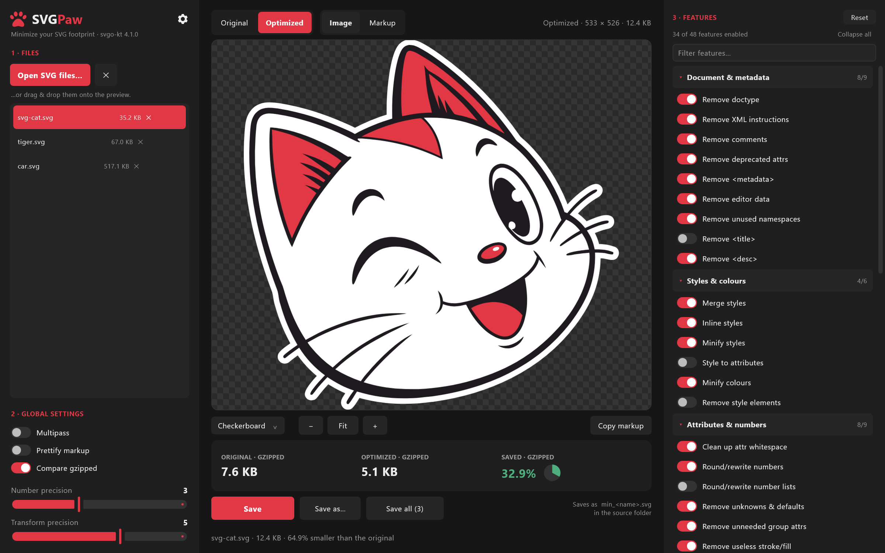
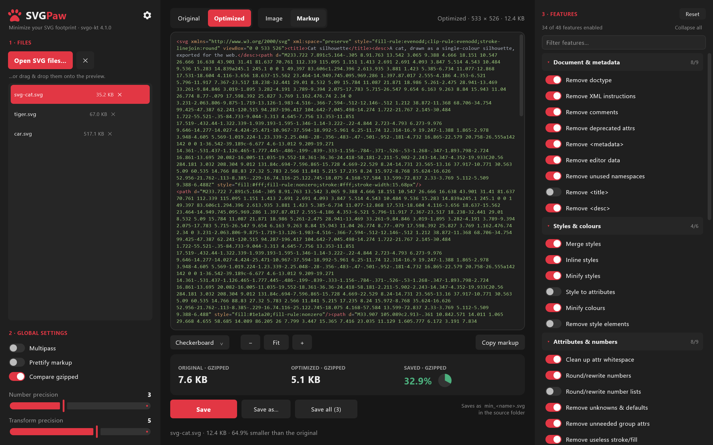
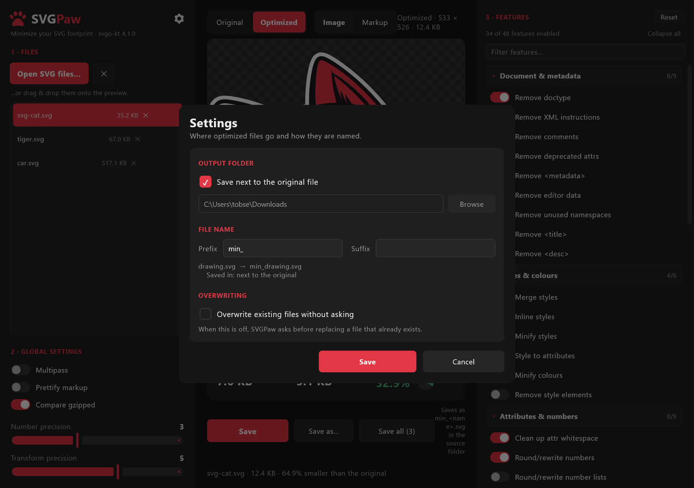

# 

> Minimize your SVG footprint

A cross-platform desktop GUI for **[svgo-kt](https://github.com/tobsef/svgo-kt)** —
the Kotlin port of [SVGO](https://github.com/svg/svgo), the SVG optimizer.



Open (or drag & drop) SVG files, tune every SVGO plugin with a **live preview**,
flip between **Original** and **Optimized** to see exactly what the optimizer
did, and write the results back with a configurable file-name **prefix**.

It is the desktop equivalent of [SVGOMG](https://svgomg.net) — same settings,
same superpowers, same output — but it works on local files, in batches, and
without a browser or Node.js.

SVGPaw is a [Kotlin Multiplatform](https://kotlinlang.org/docs/multiplatform.html)
/ [Compose Multiplatform](https://www.jetbrains.com/compose-multiplatform/)
application. The whole UI lives in one shared module and runs on the JVM
desktop, Android and the web from the same code; the desktop build is the
one documented here and the one that ships first.

---

## Features

- **Open many SVGs at once** — via the file picker, by dropping them onto the
  window, by dropping a whole folder, or as command-line arguments. `.svgz`
  (gzipped SVG) is decompressed transparently.
- **Live optimization.** Every toggle and slider re-runs SVGO on the selected
  file (debounced) and refreshes the preview and the size read-out. The run
  happens on a background worker, so the window stays responsive throughout — a
  spinner over the preview says a new version is on its way, and changing
  anything while it turns cancels that run and starts the new one.
- **Original ⇄ Optimized** with one click — or the **Space** bar. Zoom and pan
  stay locked between the two views, so the comparison is pixel-for-pixel.
- **Image and Markup views.** The *Image* view rasterizes the SVG with wheel
  zoom, drag panning and a switchable backdrop (checkerboard, white, black,
  dark). The *Markup* view shows the actual output with syntax highlighting and
  a **Copy markup** button.
- **All 48 SVGO features** in their own column, grouped into seven collapsible
  categories (*Document & metadata*, *Styles & colours*, *Attributes & numbers*,
  *Shapes & paths*, *Structure & reuse*, *IDs & references*, *Strip content*).
  Each header shows how many of its features are on, there is a filter box that
  auto-expands the groups it finds something in, and every switch has a tooltip
  with its SVGO plugin name and what it does. Global options — *multipass*,
  *prettify*, *number precision*, *transform precision* — stay on the left.
- **Compare gzipped** — sizes are reported after gzip, which is what a web
  server actually transfers. The stat headings say `· GZIPPED` when they do, so
  they are never confused with the raw sizes in the file list and the toolbar.
  Turn it off for plain byte counts.
- **Batch saving.** *Save* writes the current file, *Save all* optimizes and
  writes every loaded file with the current settings and reports the total
  saving.
- **Configurable output** — a file-name **prefix** and suffix, an output folder
  (or "next to the original"), and an **overwrite without asking** switch.
- Settings, plugin selection and the output rules are remembered between runs.
- Dark theme with a red accent. The in-app icons are SVGs rendered by the app's
  own renderer, so they stay sharp at any scale and are recoloured from the
  palette rather than from a fixed bitmap.

---

## Install

### From a packaged build

The desktop app ships as a **GraalVM native image**, so it runs without any Java
installation on the target machine. Each platform gets both a native installer
and a portable archive you can just unzip and run:

| Platform | Installer | Portable |
| --- | --- | --- |
| Windows | `svgpaw-<version>-win-x64.msi` | `svgpaw-<version>-win-x64.zip` |
| Linux | `svgpaw_<version>_amd64.deb` | `svgpaw-<version>-linux-x64.zip` |

Building these yourself is covered in [Building](#building).

### From source

Any platform a JDK 17+ runs on. See [Running from source](#running-from-source).

## Requirements

- **JDK 17 or newer** to run from source (the packaged native builds bundle no
  runtime at all — they *are* the runtime).
- The app itself needs no Node.js or JavaScript runtime — `svgo-kt` is pure
  Kotlin. (Producing the native installers/zips does use Node.js and a C
  toolchain; see [Building](#building).)

The preview is rendered with **Skia** (via [Skiko](https://github.com/JetBrains/skiko)),
the same renderer Compose itself draws with, so what you see on screen matches
what a browser shows closely enough to judge an optimization by. If a document
cannot be rendered the app still optimizes and saves — only the on-screen image
preview is skipped (the *Markup* view keeps working).

## Running from source

Use the run configurations in your IDE's toolbar, or Gradle:

```bash
# Desktop (JVM)
./gradlew :desktopApp:run
```

You can also pass files directly on the command line:

```bash
./gradlew :desktopApp:run --args="sample/svg-cat.svg sample/tiger.svg sample/car.svg"
```

The same shared UI can be launched on the other targets:

```bash
./gradlew :androidApp:assembleDebug                  # Android
./gradlew :webApp:wasmJsBrowserDevelopmentRun        # Web (Wasm)
./gradlew :webApp:jsBrowserDevelopmentRun            # Web (JS)
```

## Usage

1. Click **Open SVG files…**, or drop files onto the preview area.
2. Pick a file in the list to work on it. The preview shows the optimized
   result right away.
3. Adjust **Global settings** on the left and **Features** on the right — the
   preview and the size read-out follow every change. Collapse the categories
   you do not need; the app remembers which ones you folded away.
4. Use **Original / Optimized** (or press **Space**) to check that nothing broke.
   Zoom in with the mouse wheel to inspect edges after lowering the precision.
5. Open **⚙ Settings** to choose the output folder, the file-name prefix, and
   whether existing files may be replaced silently.
6. **Save** writes the selected file; **Save all** does the whole list.

Filtering the feature list — only the groups with a hit stay on screen, and
they open themselves:


The **Markup** view shows what will actually be written:



### Keyboard shortcuts

| Shortcut | Action |
| --- | --- |
| `Ctrl+O` | Open files |
| `Ctrl+S` | Save the selected file |
| `Ctrl+Shift+S` | Save all loaded files |
| `Space` | Toggle Original / Optimized |
| Wheel | Zoom the image preview |
| Drag | Pan the image preview |
| Double-click | Fit the image to the window |

---

## Output files



The file name is built as

```
<prefix><original name><suffix>.svg
```

with `min_` as the default prefix and an empty suffix, so `logo.svg` becomes
`min_logo.svg`. The **⚙ Settings** dialog previews the result as you type.

The target folder is either the source file's own folder (the default) or one
fixed folder for everything.

> **Careful:** with an empty prefix *and* an empty suffix, the optimized file
> replaces the original. The settings dialog warns you when that combination is
> selected. SVGPaw asks before replacing any existing file unless
> *Overwrite existing files without asking* is enabled.

---

## Settings, defaults and SVGOMG parity

The plugin catalogue, the plugin order and the way settings are turned into an
SVGO invocation follow SVGOMG's
[`svgo-worker`](https://github.com/jakearchibald/svgomg) — including its quirk
of bumping `cleanupNumericValues` to a precision of 1 when the global number
precision is 0, because 0 almost always destroys the image there.

Two plugins were renamed in SVGO 4 and use the new names here (`cleanupIDs` →
`cleanupIds`, `removeScriptElement` → `removeScripts`), and the plugins SVGO 4
added (`removeDeprecatedAttrs`, `removeXlink`, `convertOneStopGradients`,
`prefixIds`) are part of the list.

**Which features start enabled** follows SVGO 4.1's own `preset-default`. The
practical differences from SVGOMG's older list: `removeViewBox` and
`removeTitle` are **off** by default (SVGO 4 dropped both from the preset —
removing the viewBox breaks responsive scaling, and `<title>` is the image's
accessible name), and `removeDeprecatedAttrs` is **on**. Every one of them is a
single switch away.

The seven categories in the features column are a **display grouping only**.
Plugins always run in SVGO's own order, which is the order of the catalogue in
[PluginCatalog.kt](shared/src/commonMain/kotlin/io/github/tobsef/svgokt/engine/PluginCatalog.kt)
— regrouping the UI never changes the output.

### Which size is shown where

Three places report a size, and they do not always agree:

| Where | What it is |
| --- | --- |
| File list | The raw size of the file on disk. Always raw. |
| Toolbar (top right) | The raw size of the document currently shown. |
| Stat tiles | Raw *or* gzipped, depending on **Compare gzipped**; the headings say `· GZIPPED` when they are gzipped. |

### A note on "Compare gzipped"

Optimizing can make the *gzipped* size grow even while the raw file shrinks: the
original's indentation and repeated formatting compress extremely well, and
minification removes exactly that redundancy. `sample/tiger.svg` is such a case
at the default precision. Toggle **Compare gzipped** off to see the raw bytes,
and lower the **number precision** (3 → 2 is usually invisible) when a file
refuses to shrink.

---

## Configuration

Settings are stored locally in:

```
~/.svgpaw/config.json
```

It holds the output rules, the window's view preferences, which feature
categories you collapsed, and your full SVGO plugin selection. Nothing is sent
anywhere — SVGPaw is entirely offline. Delete the file to return to the
defaults.

---

## Project layout

SVGPaw is a Kotlin Multiplatform project: one shared Compose UI, plus a thin
launcher per platform.

```
SVGPaw/
├── shared/                       # the whole app: UI, model, engine, platform glue
│   └── src/
│       ├── commonMain/kotlin/…/
│       │   ├── App.kt            # the composable entry point
│       │   ├── model/            # SvgPawModel, the config store, document state
│       │   ├── engine/           # plugin catalogue + settings → svgo-kt invocation
│       │   ├── ui/               # the three columns, dialogs and components
│       │   └── platform/         # PlatformServices: files, dialogs, rasterization
│       ├── jvmMain/kotlin/…/     # desktop actuals (Skia rasterizer, FileKit dialogs, Tao drag&drop)
│       └── jvmTest/kotlin/…/     # ScreenshotTest — regenerates docs/ screenshots
├── desktopApp/                   # Nucleus launcher (DecoratedWindow, TitleBar, GraalVM config)
├── androidApp/                   # Android launcher
├── webApp/                       # Wasm / JS launcher
├── docker/                       # linux-build.Dockerfile — Linux native build container
├── scripts/                      # build-all.sh — builds Win + Linux zip & installer
├── sample/                       # three test SVGs
├── docs/                         # screenshots and the logo
└── gradle/                       # version catalogue and wrapper
```

The optimizer itself is the external **[svgo-kt](https://github.com/tobsef/svgo-kt)**
dependency (`io.github.tobsef:svgo-kt`); this repository is the front-end for it.

---

## Building

The desktop app is built with **[Nucleus](https://nucleusframework.dev)** on top
of Compose Multiplatform and ships as a **GraalVM native image** — a standalone
binary that needs no JVM on the target machine. Nucleus downloads the matching
**GraalVM CE 25** toolchain itself on the first native build (cached in your
Gradle home); you never install GraalVM by hand.

### Prerequisites

| For | You need |
| --- | --- |
| Running from source (JVM) | A JDK 17+ (any vendor) |
| Native build — Windows | The **MSVC C/C++ build tools** (Visual Studio Build Tools → "Desktop development with C++") and **Node.js 18+** (Nucleus packages the installer/zip with electron-builder) |
| Native build — Linux | `build-essential`, `zlib1g-dev`, `fakeroot`, **Node.js 18+** — or just **Docker** (see below) |
| Cross-building Linux from Windows/macOS | **Docker** |

> **`GRAALVM_HOME` gotcha.** If that environment variable points at some other
> GraalVM, Nucleus uses it instead of the pinned CE 25 and the build fails with
> `Could not find option 'SharedArenaSupport'`. `scripts/build-all.sh` clears it
> for you; if you call Gradle directly, `unset GRAALVM_HOME` first.

### One command for everything

```bash
scripts/build-all.sh
```

builds — for **both** Windows and Linux — a portable ZIP and a native installer,
and collects them in `dist/`:

| Artefact | What it is |
| --- | --- |
| `svgpaw-<ver>-win-x64.zip` | Portable Windows build — unzip and run `SVGPaw.exe`, no install |
| `svgpaw-<ver>-win-x64.msi` | Windows installer |
| `svgpaw-<ver>-linux-x64.zip` | Portable Linux build — unpack and run `SVGPaw`, no install |
| `svgpaw_<ver>_amd64.deb` | Linux installer |

A native image **cannot be cross-compiled**, so each OS is built on its own: the
Windows artefacts natively on the host, the Linux ones inside a container from
[`docker/linux-build.Dockerfile`](docker/linux-build.Dockerfile). Start Docker
Desktop first — the first Linux run downloads the GraalVM Linux toolchain and
takes a few minutes.

### Individual targets

```bash
# Portable archive for the current OS (runs without an installer)
./gradlew :desktopApp:packageGraalvmZip

# Native installer for the current OS
./gradlew :desktopApp:packageGraalvmMsi     # Windows
./gradlew :desktopApp:packageGraalvmDeb     # Linux

# Just the self-contained native folder (no archive, no installer)
./gradlew :desktopApp:createGraalvmNativeDistributable
```

Everything lands in `desktopApp/build/compose/binaries/main/`. Only the formats
listed in `nativeDistributions.targetFormats` (`Zip`, `Msi`, `Deb`) that the host
OS supports are built.

### A note on size

A Compose/Skia native image is inherently large: the self-contained folder is
~165 MB (the `-Os`-optimized binary ~120 MB, plus Skia, ICU and the C runtime).
The **installers and ZIPs compress that to ~50–60 MB**, which is the figure that
matters for distribution. `-Os` (`optimization = SIZE`) is set in
[`desktopApp/build.gradle.kts`](desktopApp/build.gradle.kts); UPX is deliberately
**not** used — it corrupts GraalVM native images on Windows (they fail to start).

### Running tests

```bash
./gradlew :shared:jvmTest        # desktop / JVM
./gradlew :shared:testAndroidHostTest
```

### Regenerating the screenshots

Every image in this README is produced by a single test that renders the real
Compose UI off-screen, so the screenshots never drift from the code. After a UI
change, run:

```bash
./gradlew :shared:jvmTest --tests "io.github.tobsef.svgokt.ScreenshotTest"
```

It loads the `sample/` files, drives the model exactly the way a click would,
waits for the optimize-and-rasterize pipeline to settle, and writes the four
PNGs in [`docs/`](docs/). See
[ScreenshotTest.kt](shared/src/jvmTest/kotlin/io/github/tobsef/svgokt/ScreenshotTest.kt).

---

## License

Provided as-is for personal use. SVGO and SVGOMG are MIT-licensed projects by
their respective authors; this is an unofficial, independent front-end.
